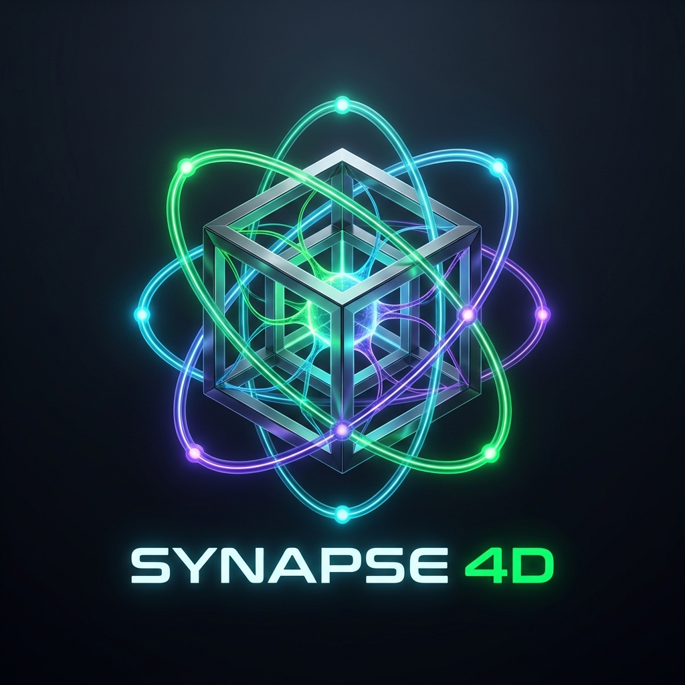
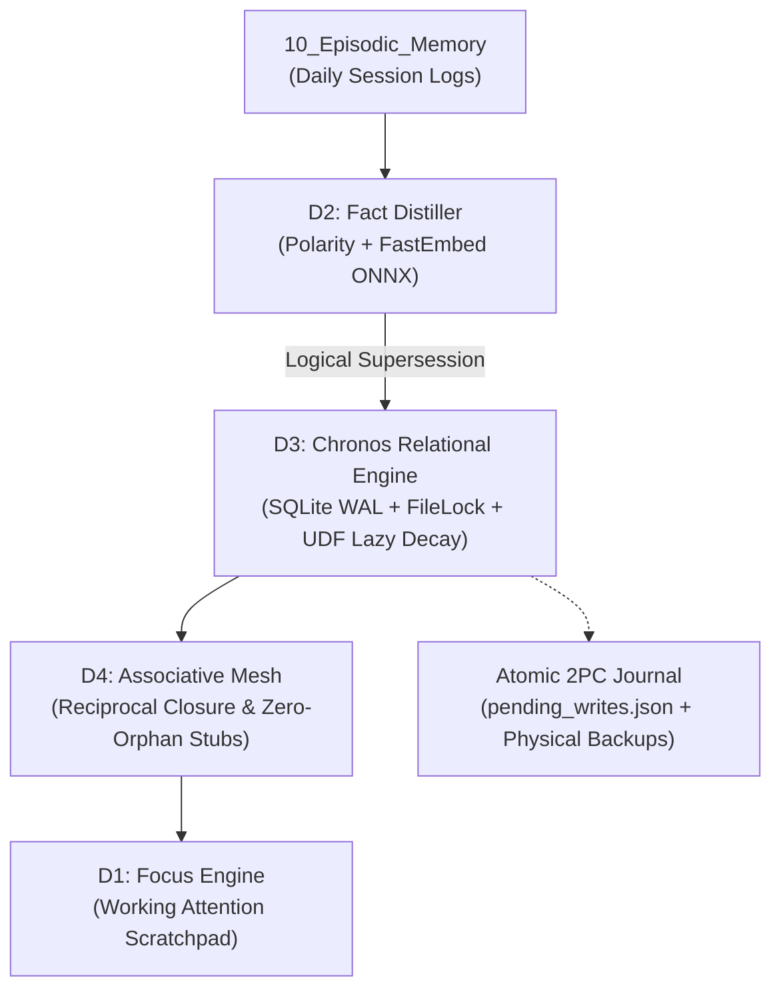

# 🧠 Synapse 4D

<p align="center">
  
</p>

<p align="center">
  <b>A Multi-Dimensional Cognitive State Matrix with Bi-Temporal Tracking, Local-First Relational Engine, and Autonomous Topological Closure for AI Agents & Obsidian.</b><br>
  <i>Sub-second, local-first artificial cognition combining Working Attention, Epistemic Arbitration, Bi-Temporal Reality Tracking, and Zero-Orphan Associative Meshes.</i>
</p>

<p align="center">
  <a href="https://doi.org/10.5281/zenodo.23737307"></a>
  <a href="https://github.com/MShesat/synapse-4d/blob/main/LICENSE"></a>
  <a href="https://www.python.org/downloads/"></a>
  <a href="https://modelcontextprotocol.io/"></a>
  <a href="./docs/WHITE_PAPER.md"></a>
  <a href="https://github.com/MShesat/synapse-4d/stargazers"></a>
</p>

---

## ⚡ The Fundamental Problem of AI Agent Memory

Autoregressive Language Models suffer from catastrophic **context degradation** ($O(N^2)$ attention overhead) and **epistemic drift**. Conventional Retrieval-Augmented Generation (RAG) paradigms provide only flat, static vector similarity:
- **No Epistemic Conflict Arbitration:** When past session logs contradict present rules (*"use Postgres"* vs *"avoid Postgres"*), flat cosine similarity returns both because they share contextual tokens, leading to hallucinations.
- **Physical Overwrite Corrupts History:** Overwriting files destroys the causal timeline. Agents cannot distinguish an intentional state transition from transient noise.
- **Topological Fragmentation:** Knowledge is stored in isolated chunks without reciprocal links, resulting in orphan data and fragmented graph traversal.

---

## 🔬 The Synapse 4D Architecture (v2.5)

Synapse 4D formalizes artificial cognitive state as a 4-dimensional manifold:
$$\mathcal{S} = \langle \mathcal{D}_1, \mathcal{D}_2, \mathcal{D}_3, \mathcal{D}_4 \rangle$$



### Core Dimensions
1. **$\mathcal{D}_1$ — Focus Engine (Dynamic Working Attention):** RAM buffer with asynchronous write-behind to Markdown, fixed token quota guards, and immediate scratchpad editing.
2. **$\mathcal{D}_2$ — Fact Distiller (Epistemic Truth Hierarchy):** Multi-tiered extraction (LLM Tool Calling $\to$ pure regex/morpheme fallback). Logical supersession (`status = 'superseded'`) replacing destructive physical deletes. Composite similarity (local ONNX vector + lexical polarity & antonym opposition).
3. **$\mathcal{D}_3$ — Relational Chronos Storage:** SQLite in WAL mode with process-level filelock. Bi-temporal attributes (`valid_from`, `valid_to`, `invalidated_at`, `superseded_by`). Zero-write-amplification Hebbian decay via SQLite User-Defined Functions evaluated at query time.
4. **$\mathcal{D}_4$ — Associative Mesh (Topological Hypergraph):** Enforces reciprocal edge closure ($A \to B \iff B \to A$) and guarantees $|V_{\text{isolated}}| = 0$ by generating minimal associative stubs with backlink provenance.

---

## 📦 Open Core Model: MIT vs Pro Edition

Synapse 4D follows a clean Open-Core architecture:

| Capability | Open Core (MIT) | Pro Edition |
| :--- | :---: | :---: |
| **D1–D4 Engines** (Focus, Distiller, Chronos SQLite, Mesh) | ✅ Full | ✅ Full |
| **CLI & Automation** (`init`, `consolidate`, `search`, `undo`, `review`, `migrate`) | ✅ Full | ✅ Full |
| **Native MCP Server** (JSON-RPC 2.0 for Cursor, Claude, Antigravity) | ✅ Full | ✅ Full |
| **Two-Phase Commit Journal** (`pending_writes.json` + crash recovery) | ✅ Full | ✅ Full |
| **Interactive HUD / Canvas Visualizer** (2D/3D Graph HUD) | ❌ | ✅ Included |
| **Zero-Terminal Obsidian Plugin** (1-click BRAT install & visual status bar) | ❌ | ✅ Included |
| **Auto-Updater & Commercial Support** | ❌ | ✅ Included |

👉 Learn more about **[Synapse 4D Pro Edition](https://github.com/MShesat/synapse-4d-pro-edition)**.

---

## 🚀 Quick Start (CLI)

### 1. Installation
```bash
pip install synapse4d
```

### 2. Initialize a Cognitive Vault
```bash
synapse4d init ./my-second-brain
```

### 3. Consolidate Episodic Sessions
```bash
# Ingests recent daily notes, distills facts, resolves conflicts, and generates stubs
synapse4d consolidate --vault ./my-second-brain
```

### 4. Audit & Health Inspection
```bash
synapse4d audit --vault ./my-second-brain
```

### 5. Review Provisional Facts
```bash
# Inspect facts flagged during heuristic fallback
synapse4d review --vault ./my-second-brain

# Promote a confirmed fact to active axiom
synapse4d review --promote f_123456789abc --vault ./my-second-brain
```

### 6. Time-Travel Deterministic Undo
```bash
# Rollback a specific consolidation session
synapse4d undo sess_20261028_120000_a1b2c3 --vault ./my-second-brain
```

---

## 🔌 Native Model Context Protocol (MCP) Server

Connect Synapse 4D directly to **Cursor**, **Claude Desktop**, **VS Code**, or **Antigravity**:

```json
{
  "mcpServers": {
    "synapse4d": {
      "command": "synapse4d",
      "args": ["serve", "--vault", "C:/path/to/my-vault"]
    }
  }
}
```

### Available MCP Tools:
- `synapse_get_working_memory`: Retrieve active focus scratchpad.
- `synapse_search_memory`: Query active facts and associative knowledge.
- `synapse_consolidate`: Trigger the 4D consolidation cycle.
- `synapse_audit_vault`: Check health score, link status, and WAL journal.
- `synapse_undo_session`: Revert a previous consolidation session.
- `synapse_review_facts`: List facts pending supervisor review.

---

## 🧪 Mathematical Verification & Theorems

Synapse 4D is formally verified with property-based testing (`hypothesis`):
- **Theorem 1 (Epistemic History Monotonicity):** Facts are never physically removed ($|\text{facts}(t)|$ is monotonically non-decreasing). Verified via `tests/test_d2_invariants.py`.
- **Theorem 2 (Zero-Orphan Closure):** $|V_{\text{isolated}}| = 0$ for all topological entities. Verified via `tests/test_d4_invariants.py`.
- **Theorem 3 (Crash Atomicity):** Reconciles corrupted disks post-`SIGKILL` using physical snapshots. Verified via `tests/test_journal_recovery.py`.

```bash
# Run all verified invariant and integration tests
pytest -v
```

---

## 📄 License
MIT License © 2026 MShesat. Commercial extensions licensed under Synapse 4D Commercial License.
